<h1 align="center">Spica</h1>

<p align="center">
  <b>Offline desktop software for drug target triage</b><br>
  Each value shows its source and its release<br>
  Each gap shows its cause
</p>

<p align="center">
  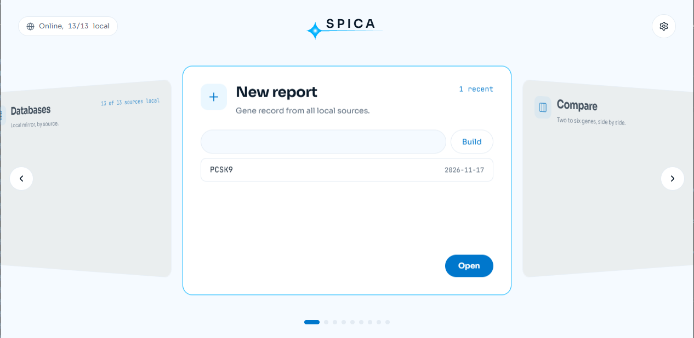
</p>

<p align="center">
  Python · React · TypeScript · Tailwind CSS · pywebview · igv.js · PyDESeq2 · llama.cpp
</p>

---

## Overview

Target triage needs data from many databases: expression, protein structure, genetics, tractability, safety and clinical precedent  
Each database has its own identifiers, formats and releases, and a comparison across genes takes many browser tabs

Spica collects this data into one record per gene  
It keeps a local copy of 13 public databases, so it works without a network connection  
It records the source, the release and the retrieval date of each value  
When a value is missing, the record states why: not found, not covered by the source, or query failed  
The same gene and the same releases always give the same record

## Features

### Gene report

A report has about 90 typed fields in eight sections: identity, genomics, transcriptomics, proteomics, organ-level RNA and protein, essentiality, clinical data and derived measures  
The release badges at the top show which version of each source the report uses

<p align="center">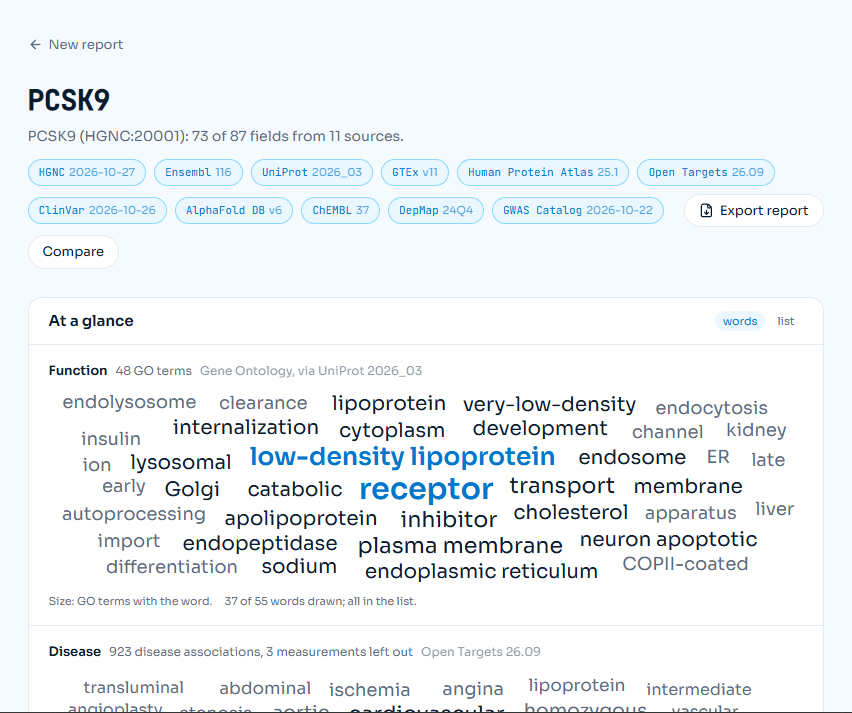</p>

### RNA and protein by organ

Four atlases (GTEx, HPA, HPA single cell, HPA mass spectrometry) use different tissue names  
Spica maps them to one organ axis and compares the transcript with the protein in each organ  
A row with high RNA and no protein gets a flag, because this difference needs an explanation

<p align="center">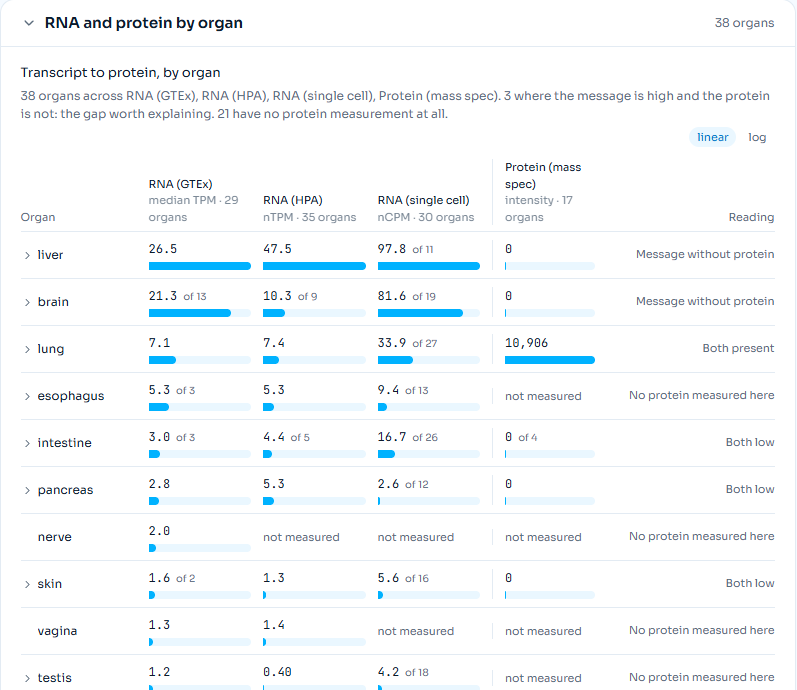</p>

### Protein structure

The view shows three tracks along the sequence: AlphaFold confidence (pLDDT), AlphaMissense pathogenicity and the number of PDB entries that cover each residue  
The list below sorts the PDB entries by resolution

<p align="center">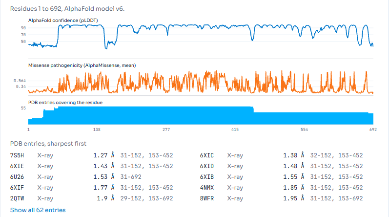</p>

### Genome view

The genome view uses igv.js and shows the gene with 50 kb on each side  
Tracks: GENCODE, Ensembl Regulatory Build, ENCODE cCREs and TF clusters, ClinVar, dbSNP, GTEx eQTLs, phyloP conservation, and DNase, H3K27ac and RNA coverage per tissue  
The view also accepts any ENCODE experiment and any bigWig, bigBed or peak file from a GEO series  
Spica maps GRCh37 files to GRCh38 with the Ensembl assembly map  
Python reads all tracks; the interface never connects to the network

<p align="center">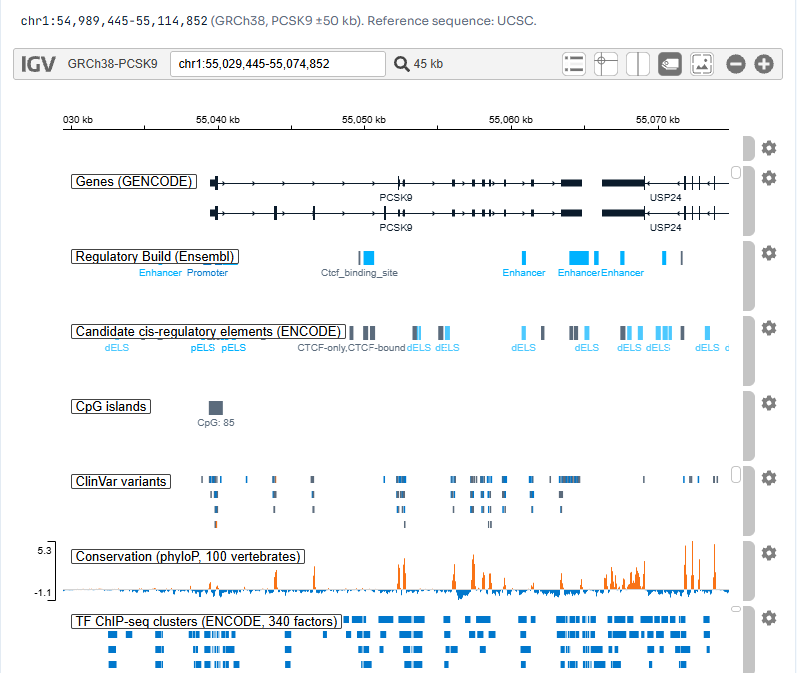</p>

### Transcription factors at the promoter

Spica takes the regulators of the gene from OmniPath and the JASPAR 2024 motif of each regulator  
It scans the promoter on both strands and calculates exact p-values (threshold p < 1e-4)  
Then it compares each motif site with the ChIP-seq peaks of the same factor in ENCODE  
A site inside the factor's own peak has two independent lines of evidence

<p align="center">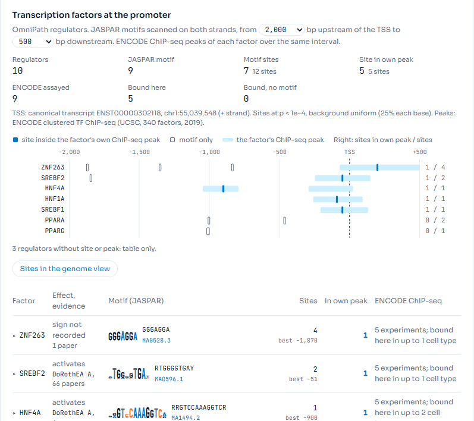</p>

### Gene comparison

The comparison shows two to six genes side by side  
The specificity map plots tissue specificity (tau) against the peak over the median tissue  
Genes in the top right corner have the most restricted expression

<p align="center">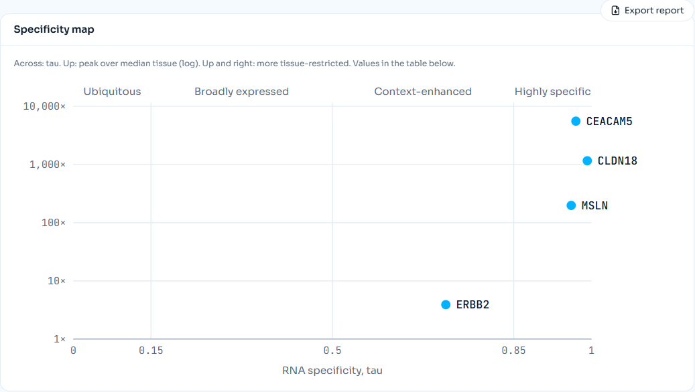</p>

### Candidate ranking

A gene list goes through HGNC first: Spica shows each alias, previous symbol and ambiguous entry before it ranks the list  
The ranking uses weighted criteria in six groups: expression, druggability, precedent, disease relevance, safety and translation  
Each weight is on a scale of 0 to 10, and presets exist for antibodies, small molecules, cell therapy and oncology  
The table updates immediately when a weight changes

<p align="center">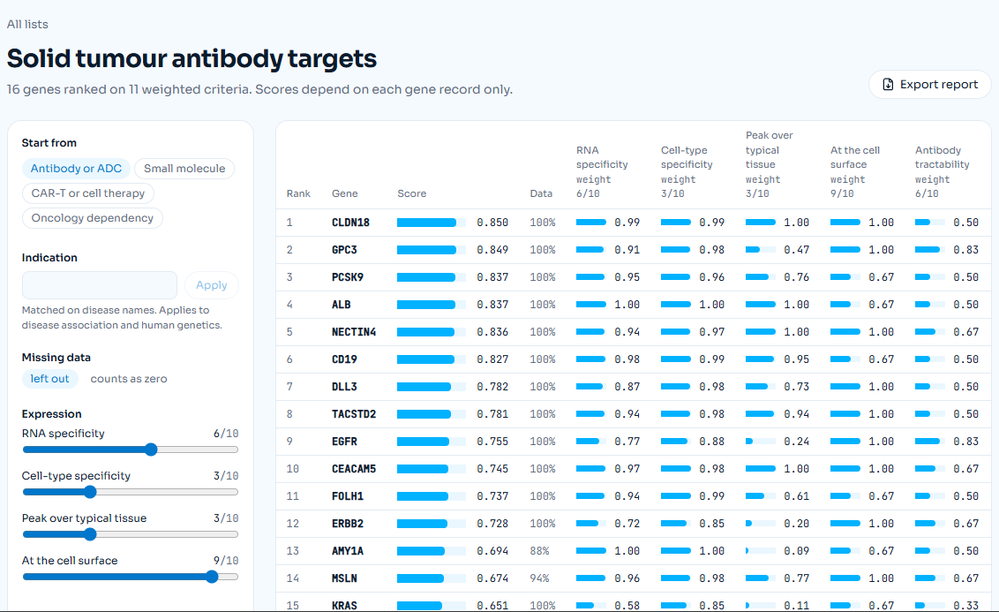</p>

### Benchmark

The benchmark tests the weights  
It scores targets with an approved drug against decoys (protein-coding genes with no drug in the clinic) and calculates a ROC curve and the AUC  
Criteria that contain the label (clinical precedent, disease association) are removed from the run, so the score does not include the answer

<p align="center">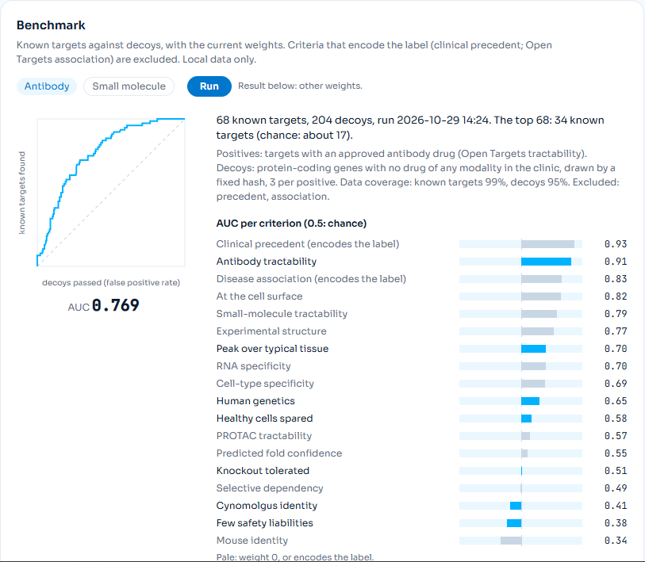</p>

### GEO datasets and differential expression

Spica searches GEO, reads the sample annotations of a series, and groups the samples by their variables  
It reads the value of a gene in each sample and shows the tracks of the series on the genome view

For differential expression, Spica accepts only validated methods:

| Table in the series | Analysis |
| --- | --- |
| Results from the authors (DESeq2, edgeR or limma columns) | Shown as published, not calculated again |
| Raw integer read counts | DESeq2 (PyDESeq2) with the DESeq2 default settings |
| TPM, FPKM or other normalised values | Refused, because no validated test applies |

<table>
  <tr>
    <td>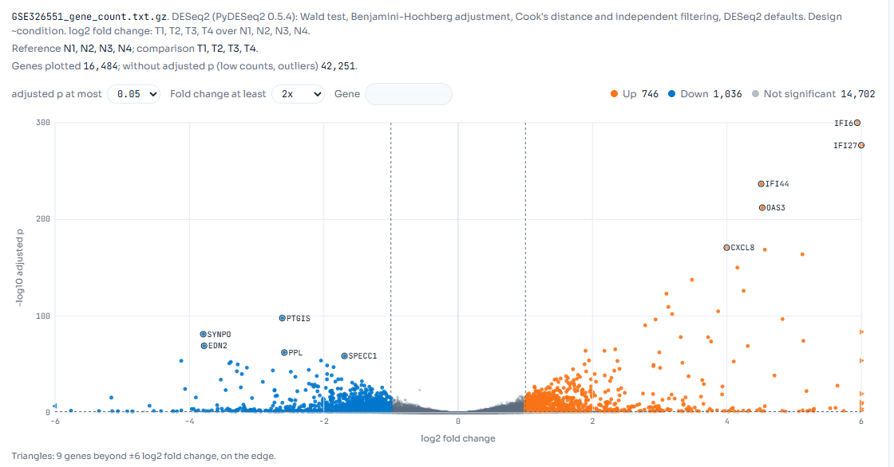</td>
    <td>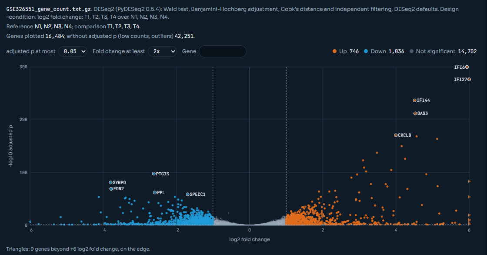</td>
  </tr>
</table>

### Competitive intelligence

A watch searches papers and preprints (Europe PMC), clinical trials (ClinicalTrials.gov) and patents (EPO Open Patent Services) for a topic  
Each check stays on disk, so the next check shows only the new items

<p align="center">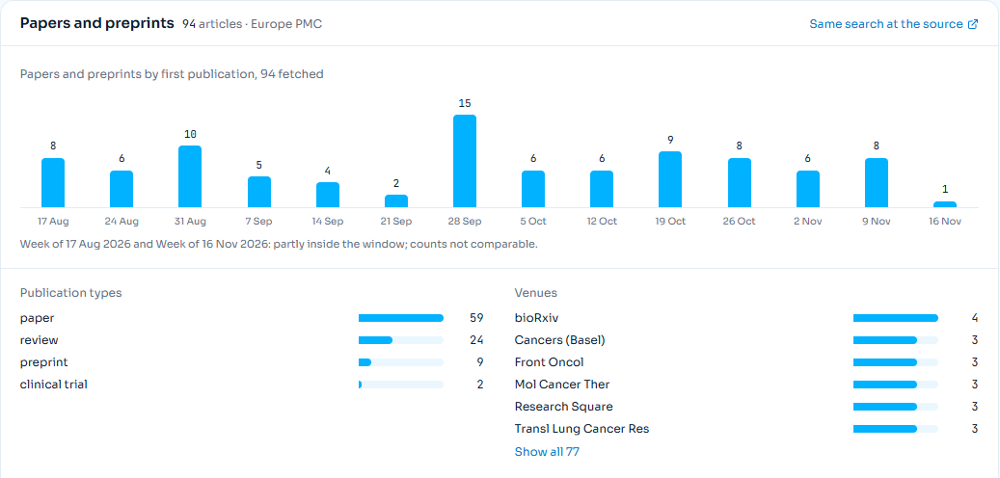</p>

### More

- **Podcast digest**: Spica transcribes journal and society podcasts on the local computer with whisper.cpp and searches them together with trials and papers  
  It does not transcribe a feed when the publisher reserves text and data mining (TDMRep or copyright statement)
- **AI mode**: a local language model (llama.cpp, GGUF) answers questions with the tools above and with indexed documents  
  A verifier written in code checks each citation and each cited number against the tool output  
  The user can roll back any step and run it again
- **Report export**: one HTML file for a gene, a comparison or a ranked list, with all sources and credits, ready to print on A4
- **Light and dark themes**: the dark theme has its own colour steps, and the chart colours pass a colour-vision check in both themes

## Validation

A published DESeq2 analysis is the reference for the DESeq2 route  
The series GSE326551 contains raw counts and the authors' results for the same comparison (4 samples against 4)

| Measure | Agreement over the 1,778 genes in both tables |
| --- | --- |
| log2 fold change | Pearson r = 1.000000, largest difference 0.0001 |
| -log10 adjusted p | Pearson r = 0.9997 |
| Adjusted p < 0.05 | 1,771 calls are the same; the 7 other genes are at the threshold |

The full method and its limits are in [docs/differential-expression.md](docs/differential-expression.md)

## Data sources

| Source | Data that Spica uses |
| --- | --- |
| HGNC | Gene names, aliases, previous symbols, cross-references |
| Ensembl | Coordinates, biotypes, orthologs in mouse and cynomolgus |
| UniProt | Protein names, locations, topology, GO terms, PDB cross-references |
| GTEx | RNA by tissue, transcripts by tissue, co-expression |
| Human Protein Atlas | RNA, single cell, antibody staining, mass spectrometry, subcellular location, interactions |
| Open Targets | Disease associations, tractability, safety liabilities |
| ClinVar | Variants by classification |
| GWAS Catalog | Trait associations |
| AlphaFold DB | Model confidence and per-residue AlphaMissense |
| ChEMBL | Drugs, phases, mechanisms, activities |
| DepMap | Gene effect and dependency by lineage |
| STRING | Physical interaction network |
| OmniPath | Regulators and interactions (commercial-use records only) |

Each source went through a licence check before it went in  
The results are in [docs/licences.md](docs/licences.md)

## Architecture

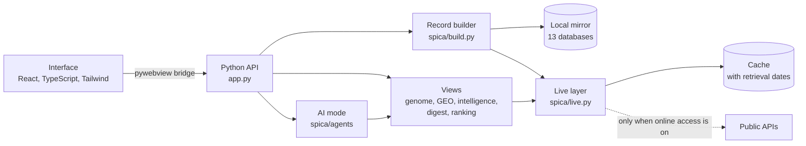

- The interface calls Python directly through pywebview; there is no web server
- The interface never connects to the network; Python makes all requests and caches each response with its date
- A source in the mirror is never fetched from its API
- Online access is off by default

## Getting started

```bash
git clone https://github.com/ThomasCpy/Spica-MultiOmics-Integration.git
cd Spica-MultiOmics-Integration
./run.sh               # macOS, Linux, Git Bash or WSL
run.cmd                # Windows
```

The first run installs a private Python in `runtime/`, installs the dependencies there and builds the interface  
Nothing goes into the system, and the PATH does not change  
To remove everything, delete `runtime/`

```bash
./run.sh --cli PCSK9   # show a record in the terminal
./run.sh --dev         # use the Vite development server
./run.sh --agents      # add the local model runtime
./run.sh --speech      # add the transcription engine
```

The databases are not in this repository  
To build the local mirror, use Settings > Databases or `tools/build_mirror.py` (sizes in [docs/data-mirror.md](docs/data-mirror.md))  
Without the mirror, set Online access to on: Spica then fills the records from the public APIs and caches them

To make the Windows executable:

```bash
./build.sh             # or build.cmd, writes dist/Spica.exe
```

## Tests

```bash
python -m unittest discover -s tests
```

The suite has 490 tests and runs in a few seconds without a network connection  
It uses a small synthetic mirror in `tests/fixtures/` (three genes, short sequences) and stub HTTP responses

## Project structure

| Path | Contents |
| --- | --- |
| `app.py` | Window and the API that the interface calls |
| `spica/schema.py`, `spica/record.py` | Record schema, values, provenance, null states |
| `spica/sources/` | One adapter per database, mirror first, API as fallback |
| `spica/metrics.py`, `spica/dogma.py` | Derived measures, organ mapping |
| `spica/ranking.py`, `spica/benchmark.py` | Ranking criteria, presets, benchmark |
| `spica/genome/`, `spica/tfscan.py` | Genome tracks, bigWig and bigBed reader, TF scan |
| `spica/geo/` | GEO search, series records, tracks, differential expression |
| `spica/intel/`, `spica/digest/` | Competitive intelligence, podcast digest |
| `spica/agents/`, `spica/corpus/` | Local model loop, verifier, document index |
| `frontend/src/` | Interface (React, TypeScript, Tailwind v4, Vite, igv.js) |
| `tools/` | Mirror builder, executable build, third-party notices |
| `docs/` | Design, data sources, licences, method notes |

## Design rules

- A missing value is never a blank or a zero; it shows its cause
- A chart keeps its numbers, so it is also clear in grayscale and for readers with colour-vision deficiency
- Red and green are never a pair; up and down use orange and azure
- No GPL or AGPL package goes into the executable
- Colours, typography and writing rules are in [docs/art-direction.md](docs/art-direction.md)

## Licence

Copyright (c) 2026 Thomas Charpenay  
Spica is available under the [PolyForm Strict License 1.0.0](LICENSE)

| Use | Permitted |
| --- | --- |
| Personal use, research, study, testing | Yes |
| Use by charities, schools, universities, public research and health organisations, governments | Yes |
| Commercial use | No |
| Changes, or new works based on the software | No |
| Redistribution of copies | No |

There is no activation and no licence key  
The summary in [docs/licensing.md](docs/licensing.md) does not replace the licence text  
[THIRD_PARTY_NOTICES.md](THIRD_PARTY_NOTICES.md) lists the open-source components and their licences
